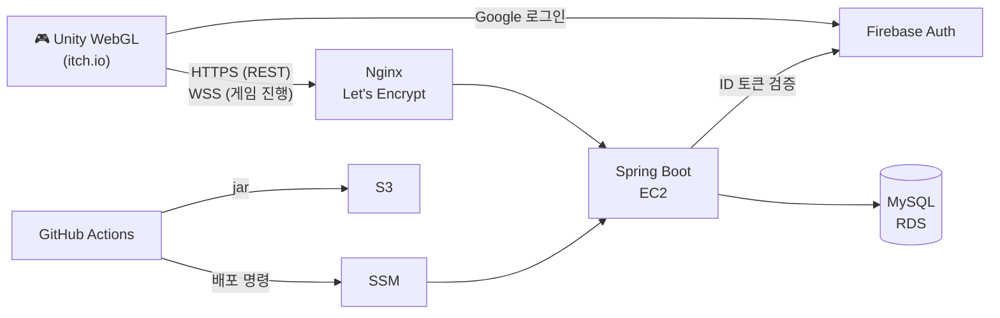

# 🎲 직업 윷놀이

**익숙한 윷놀이 규칙에 12가지 직업을 더한 실시간 온라인 멀티플레이 게임**

팀 **도·개·걸·윷·모** (내일배움캠프 Unity 단기심화 8조)

---

## 📖 소개

윷놀이는 누구나 규칙을 알지만, 결과가 윷에 크게 좌우되어 매 판이 비슷하게 흘러갑니다.

**직업 윷놀이**는 게임을 시작할 때 무작위로 나온 직업 후보 3개 중 하나를 골라 **나만의 규칙**을 갖고 플레이합니다.
같은 '도'가 나와도 누가 던졌느냐에 따라 전혀 다른 수가 되고, 내 직업의 장점을 살리면서 상대 직업의 약점을 파고드는 **수 싸움**이 생깁니다.

- 👥 **2~4인 개인전** 실시간 대전
- 🌐 **설치 없이 브라우저**에서 링크 하나로 바로 플레이
- 🛡️ 윷 결과·말 이동·직업 효과는 모두 **서버가 판정**

## 🃏 12가지 직업

| 직업 | 효과 | 직업 | 효과 |
|:---:|---|:---:|---|
| 🐸 청개구리 | 빽도가 나오면 앞으로 한 칸 | 🗡️ 암살자 | 이동 후 한 칸 앞의 상대 말을 잡음 |
| 🏃 스프린터 | 새 말을 올릴 때 한 칸 더 | 🧍 외톨이 | 판 위에 말 하나만, 대신 잡히지 않음 |
| 🎰 야바위꾼 | 턴의 첫 결과를 한 번 다시 던짐 | 🏹 사냥꾼 | 잡으면 두 번 더, 윷·모 추가 던지기 없음 |
| 🛡️ 경호원 | 업힌 말이 잡혀도 맨 위 한 마리만 돌아감 | 🎲 도박사 | 도는 모로, 모는 도로 |
| 🧘 수행자 | 도·개일 때 한 칸 더 | 👴 노장 | 말이 하나 적은 대신 윷·모일 때 한 칸 덜 |
| 🕊️ 평화주의자 | 잡히지 않는 대신 잡을 수 없음 | 🏃‍♂️ 마라토너 | 지름길 불가, 대신 한 칸 더 |

## ✨ 주요 기능

| 🎮 게임 플레이 | 🔗 매칭·연결 | 🏆 계정·성장 |
|---|---|---|
| 직업 선택 (후보 3개 중 1개) | 방 코드로 친구 초대 | 구글 로그인 / 게스트 |
| 2~4인 실시간 대전 | 빠른 참가 | 전적 기록 |
| 턴 제한시간 | 30초 재접속 유예 + 끊긴 동안 자동 진행 | 업적 13종과 골드 보상 |
| | | 프로필 아이콘 뽑기 |

## 🛠️ 기술 스택

| 영역 | 기술 |
|---|---|
| **Client** |    NativeWebSocket |
| **Server** |    WebSocket · REST |
| **Auth** |   JWT |
| **DB** |  |
| **Infra** |     Let's Encrypt · SSM |
| **CI/CD · Tool** |    |

## 🏗️ 아키텍처

- **REST**: 방 만들기, 빠른 참가, 전적·업적·뽑기처럼 요청 한 번에 응답 한 번이면 끝나는 기능
- **WebSocket**: 윷 던지기, 말 이동, 직업 선택처럼 모든 플레이어에게 즉시 전달해야 하는 게임 진행
- **서버 판정**: 클라이언트는 의도만 보내고 결과는 서버가 확정. 상태 해시를 비교해 플레이어 간 화면 어긋남을 감지
- **무SSH 배포**: main에 push하면 GitHub Actions → S3 → SSM으로 EC2에 배포 (SSH 포트·키 노출 없음)

## 📊 부하 테스트 (k6)

실제 배포 서버(EC2 + Nginx + RDS)에 가상 유저가 게스트 생성 → 빠른 참가 → WebSocket 입장 → 메시지 왕복을 반복하는 시나리오로 측정했습니다.

| 동시 접속 | REST p95 | REST 실패율 | 방 참가 성공률 | 메시지 p95 |
|:---:|:---:|:---:|:---:|:---:|
| 500명 | 16ms | 0% | 99.95% | 8ms |
| **1000명** | **15ms** | **0%** | **100%** | **8ms** |

- 빠른 참가 동시성 문제(같은 자리 중복 배정)를 **10초 자리 예약**으로 해결해 `ROOM_FULL` 오류 0건
- Nginx `worker_connections` 한도를 올려 1000명 접속 시 연결이 끊기던 문제 해결

## 📂 Repositories

| 저장소 | 설명 |
|---|---|
| [**AugmentedYutNori**](https://github.com/TeamYutNori/AugmentedYutNori) | Unity 6 클라이언트 (WebGL) |
| [**AugmentedYutNori-Server**](https://github.com/TeamYutNori/AugmentedYutNori-Server) | Spring Boot 게임 서버 |

## 👥 Team

| 이름 | 역할 | 담당 |
|:---:|:---:|---|
| [이정빈](https://github.com/JB1112) | 팀장 · Client · Server | 서버 판정 게임 로직, 직업 서버 규칙, 게임 종료·이탈·자동 진행, 업적, 부하 테스트 |
| [박소희](https://github.com/THGM1) | Client · Server | 상태 동기화 검증, 턴·직업 선택 타이머, 연결 끊김·재접속 복원, 전적 저장 |
| [박형호](https://github.com/Hyeongho624) | Client · Server | 클라이언트 Core 규칙, 플레이어·로그인·프로필, 방 생성·대기실·방장 시작 |
| [박진우](https://github.com/tree6316mte) | Client · Server | Firebase·JWT 인증, 게스트 로그인, 뽑기 시스템, 윷판 구조 초기 설계 |
| [이승욱](https://github.com/Potato-Gamja) | Client | 게임 진행 흐름, 보드·말 연출, 멀티플레이 화면 동기화, UI·HUD, WebGL·모바일 대응 |
| [조창일](https://github.com/changil98) | Client · Server · Infra | WebSocket 통신 기반, 직업 시스템(클라), 로그인 보안 설정, AWS 배포·CI/CD |
